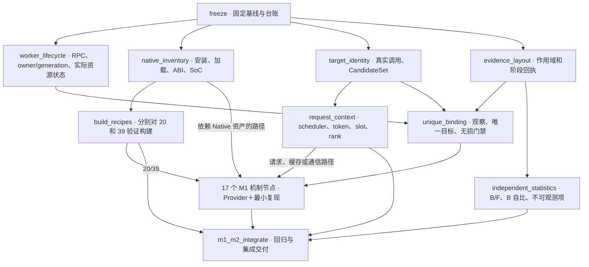

# DemonCATPFI 17 条故障覆盖路线图

2026-11-17 冻结工程基线 `b0d15696a0c4355c9226c391fb95d3e5ad0ba96c`。本轮交付 M1/M2 的开发基线、17 条实现和证据对账、最小复现及任务分工。实际运行的代码和证据来自所列提交及回执。首轮仅做只读核对和本地校验，新增 NPU 调用为 0。

[机器可读验收台账](17_fault_acceptance_matrix.json) · [上轮验收](../../experiments/p3p4_closure_20261117/README.md) · [公共 Worker 正向闭环](../../experiments/worker_positive_20261117/FINAL_REPORT.md) · [17 张原能力卡](../overnight_fault_cards/README.md)

## 基线与完成口径

目录有 **17 个机制 ID**。公共 Worker 已登记且具备明确作用域的正向证据为 **4 条**，其中 20 仅包含 WeightNz。台账从六个实测用例核对实际命中、无损阶段、完整模型输出和 OFF 恢复。15、17、18 的构造模块已在 NPU 上验证。33 有独立 HF 的真实连续生成。其他历史结果按原实现、部署和作用域保存。基线 599 项 CPU 测试来自上轮回执。公共 `all_eligible` 与 `every_match` 资格均为 **0/17**。 [基线回执](../../experiments/p3p4_closure_20261117/summaries/cpu_p4_final.json) · [独立覆盖矩阵](../../experiments/overnight_20261116/coverage_matrix.json)

| 阶段 | 里程碑和通过条件 |
| --- | --- |
| 1 工程覆盖 | M1 为 17/17 提供真实逻辑、专用 Provider、可执行的唯一目标入口、可查询的资源状态、OFF/Recovery 和逐机制最小复现。M2 同期交付公共 Worker、Model/Operator Adapter、Native Build Manager 与取证接口。 |
| 2 实机闭环 | M3 在各机制声明的环境中确认 17/17 的真实 NPU 单目标 E1–E4。E5 单独记录独立比较、定位结论和范围。已就绪路径可逐条验收。 |
| 3 模型、版本与设备 | M4 覆盖声明支持的真实 Qwen Dense/MoE、GLM、DeepSeek MLA/MoE 路径。M5 覆盖各 Provider 自己声明的 CANN 8.x/9.x、A2/A3 组合，以实际加载指纹及实机回执为准。 |
| 4 覆盖与生产接线 | M6 在有界场景逐机制验证全部合格目标、持续触发、请求和 rank 隔离及整组恢复。M7 获得黄区实装源码与测试环境后，通过现役 CLI、Catalog、Controller、Worker 和 Native 恢复链验收。 |

M1/M2 的完成需要真实可调用实现、严格参数校验、候选与拒绝原因、原操作执行回执、机制效果、关闭和资源释放。Native 机制在 M1 交付可构建源码、头文件与 ABI 合同、构建回执和最小入口。CPU/Mock 用例用于验证选择、异常和恢复合同，真实硬件资格在 M3 单独记录。目录登记、只读能力卡或待定 factory 本身均无法满足 M1。

## 17 条逐项核对

实现路径及对应 Git 对象哈希、已有入口、剩余代码、接线、构建与恢复缺口、最小复现的输入和验收条件均在台账中。阶段顺序复用已验证的 20/39 样板，后续开发资源优先给缺真实实现或接线的条目。 [逐项数据](17_fault_acceptance_matrix.json)

| 机制 | 冻结时可运行位置及证据 | M1 最小交付 |
| --- | --- | --- |
| 8 `restore_offset` | 有历史 MoE 解排列结果，找回配对路由部分源码，缺依赖及可信请求作用域 | 一个多 token prefill 的真实 `token_combine → npu_moe_token_unpermute`，成组移动索引与权重，核对原调用、消费及同进程 OFF |
| 15 `alias_detach` | `attach` 能执行，NZ29 的构造视图写入/原 base 消费 B/F/OFF 已通过，严格统计调用结构不齐 | 植入统一 Worker 的拥有者状态，复用 64 个目标元素、非目标元素和真实消费者检查。自然模型路径逐项调整 |
| 17 `spatial_padding` | `attach` 下的标准 Conv3d 原调用，构造模块验证 padding 由 (0,0,0) 变为 (0,7,7) | 按实际 patch 结构和调用选择一次 Conv3d，比较形状、完整数值及关闭恢复 |
| 18 `api_half` | 标准 RMSNorm 返回增益代理，构造模块 B/F/OFF。原 RMSNorm hook 可先看到未改值 | 核对原 Norm、返回值与实际 add 消费者。标准与自定义/融合边界分别配置 |
| 20 `buffer_substitute` | WeightNz 受控 NZ/PTA 的 Qwen3/SmolLM2 单投影闭环。QMM 有 typed 实现和旧实验，当前真实 DeepSeek 268 次 Run 为只读 | WeightNz 回归和一个真实中间 QuantMatmulWeightNz 投影分开，均校验现用 executor、slot、无损、临时输入与实际 OFF |
| 22 `wrong_row` | 旧固定 RoPE 错行代理有 B/F 证据，当前无可重用实现 | 实际 RoPE cache 与合法索引绑定，真实 IndexSelect 后替换一行，核对同一下一消费者和原缓存 |
| 25 `reduce_scatter` | CPU 归约次序与分片设计，真实 collective 适配尚缺 | 一个真实后端的有界通信组，绑定 rank/sequence、实际一次通信及每份贡献，逐 rank 等待、撤销与复验 |
| 26 `residual_stomp` | 独立 QMM writer 的旧模型执行和恢复。旧宿主为采集包装了 runner.execute_model，公共 Worker 需重新接线。rank1 写前 NaN 来源未闭合 | 同 forward 的真实 producer、两个活跃相邻分配、一次 QMM 和真实 consumer，逐块恢复。非邻接透传 |
| 26 `fia_destination` | SmolLM2/GLM4 公共 Worker 有 29/39 次实际写入、消费及恢复 | 复用实际 FIA V3 和 residual 合同，保留 out 回拷、消费、恢复与 pending，加入共用回归 |
| `quant.batch_shared_scale` | 真 DeepSeek-V2-Lite 公共 Worker 首 B8 decode 的一个真实 V2 投影 | 固定请求行和设备输入，原 V2 一次读取改变后的归约域，逐行 Q/scale、完整 logits 与 OFF 检查 |
| 28 `fa.legal_tiling` | 真实 FA S1S2 的固定证书和策略层，当前基线缺匹配 Native 构建接入与模型 forward 桥 | 对一条实际 FA 调用切换证书内的合法 M，核对实际 POD/raw/launch，验证关闭恢复。M 和 ratio 分开查 |
| 28 `fia.legal_tiling` | 固定 Python FIA 路由与旧真实合法切分证据，0.1% 统计幅度目标未达 | 固定同一 Q/K/V 的因果切分，健康模板 512→128，验证循环、尾块、workspace、合法 key 和 OFF |
| 28 `fia.denominator_replay` | 不同的历史 kernel 错误，B8 三步统计首差和 OFF 已有历史证据，当前基线缺完整 kernel 构建接入 | 固定 M/S2=128，第二块重复首块分母贡献，实际执行对应 replay key，健康 key 恢复 |
| 33 `paged_decode` | 独立 HF 真实连续 decode，首个 KV16384 的 28 层实际切分。后续 3 步传播，OFF 精确 | 绑定真实 Worker 当前请求、页表和 live KV，校验一条合格 paged IFA 的策略、原页与 OFF |
| 39 `matmul_range` | 独立 ABI v1 有四个具体 CANN 算子版本证据。当前公共 Qwen3 TP1 单投影闭环 | 复用单次真实 BF16 MatMul，独立核对 self/mat2/dual 无损、有限输入到非有限输出及原存储恢复 |
| 39 `output_proxy` | 旧 C++ post-Run 代理可定位，当前缺独立 Provider 与 out/consumer 合同 | 提取有限 out 后的受控 prefix 写入，验证原调用、输出槽和下游真实消费，完成 drain 与 OFF |
| 41 `tail_column` | 旧 preload 加载和 arm 有记录，实际 dispatcher 零调用，B/F 相同 | 先观察真实 writer 和请求 slot，再在 writer 后改变已证明的 live 尾列，验证同 storage 消费及逐字节恢复 |

8 的真实后端取决于可观察的 TorchNPU 调用与缺失依赖。22 的可执行源在此前有限搜索中未找到。25 的 CPU 设计以真实同输入通信证据作为差值代理前提。普通双卡两项 FP32 加法交换顺序不能独立证明多项求和的结合次序误差。41 要从真实 dispatcher 或 typed executor 发现 writer，旧同名动态符号试验的零命中单列。 [历史源码与搜索范围](../../experiments/overnight_20261116/legacy_source_audit.json) · [25 设计](../../experiments/overnight_20261116/collective25_design.py) · [41 旧失败](../../fault20_fast_validation/reports/fault41/fault41_tail_column_poison_smoke_20260901.md)

28 的 Native 导入有明确来源。FA 的 `native_execution_strategy/native/{BUILD.md,fa_bridge.h,build_cpu.py}` 可在历史提交 `6dad85c480255829b0a4e74657a7e2ff2ce390b3` 复核。FIA 更近的 `fault28_statistics_visible_20261113_r2` 与 `fault28_reduce_replay_20261113` 目录已在已有本地工作树定位。M1 需按各自 host、kernel 改动、matching SDK、源码与工件哈希审查导入。目录位置仅作找源线索。33 也应将单独审计过的 paged host/vendor 构建视作部署输入，核验所在镜像的实际加载与 launch。 [源码资产索引](../unified_fault_inventory.md#资产来源) · [33 正式实测](../../experiments/p3p4_closure_20261117/FAULT33_REPORT.md)

## M1/M2 依赖和文件所有权

下面的图对应台账的 10 个公共节点和 17 个机制节点。基线固定后，Worker 生命周期、Native 盘点、目标身份及取证协议可并行。各机制只等待自己需要的接口和构建。已有实测样板可以用于回归，符合条件的机制可以单独进入 M3。



| 工作流 | 负责内容 | 文件所有权 |
| --- | --- | --- |
| A Native Infrastructure | 安装/实际映射、可复用 build recipe、ABI/ELF 与加载验证 | `fault_injection/environment.py`、Fault39 的 profile/部署验证、20/39 构建和 ABI 探针。旧共享 preload 由 A 管理，D 将输出代理提取到独立文件。 |
| B Model/Operator Adaptation | 模型对象和逻辑角色、真实算子边界、请求及候选身份 | `model_discovery.py`、`runtime_discovery.py`、`coverage.py`、`attention.py`、`serving_context.py`、`batch_context.py`、`call_binding.py` 及对应合同测试。 |
| C Fault Providers 1 | 8/15/17/18/20/22/25，含20两条 operator adapter | `alias.py`、`module_faults.py`、20 的 `deployments/{matmul,buffer20}.py`、`serving20.py` 与 `providers/fault20.py`。8/22/25 单机制文件和测试。 |
| D Fault Providers 2 | 26 两变体、量化、28 三变体、33、39 两变体、41 | 各自 `deployments/`、28 策略与 FIA 路由、量化与真实 serving 文件、39 native/runtime 和 provider。新增专用实现与机制测试。 |
| E Validation & Evidence | 环境与作用域关联、运行和恢复回执、原始统计比较、覆盖对账 | 现有 evidence contract、独立 msprobe 比较器及诊断，后续证据规范和验收脚本。B 持有覆盖组件源码，E 使用独立观察计数和接口输出复核。 |

总控独占 `catalog.py`、共用会话和 resolver/runtime/extension、路线图及验收台账的合并写入。改公共文件先由负责方提交接口变更，其余工作流用该接口和专属实现。每项合入前运行机制相关测试，有 Native 改动附无设备构建回执，有实机执行附真实命中和恢复回执。每阶段独立 Git commit。 [机器任务依赖及所有权](17_fault_acceptance_matrix.json)

## 公共接口的开发顺序

1. **Worker** 复用 `DemoncatWorkerExtension` 和现有 prepare/register/check/execute/advance/query/finish/disable/clean。由正常 serving 创建 Worker，Extension 只绑定实际模型及调用，避免替换 `execute_model`、`_prepare_inputs`。按机制、owner、generation 读取实时状态，Worker 重建使旧票据失效。当前 `_fresh()` 查询要求 `native_loaded=True`。Python hook、tensor 和 API 代理需要真实的包装归属、在途调用和释放状态。Native Provider 仍须有现有原生门禁。失败时保留待恢复状态和可追溯回执。 [生命周期实现](../../src/demoncat/runtime/vllm_ascend/worker_extension/runtime.py)
2. **Model/Operator Adapter** 从实际对象和逻辑角色出发，经正常 forward 观察真实算子、typed metadata 和 caller/consumer。候选保留已观察、未观察、不支持与歧义。用各边界真实身份表示 alias/storage、API、OpCache、kernel launch、page/cache 或 collective group/sequence。拓扑发现不给未执行的算子放行。至少完成无损门禁再首次注入，同一调用必须含原实现执行证据。层名进入诊断而无需用户提供。 [结构发现](../../fault_injection/model_discovery.py) · [实际调用发现](../../fault_injection/runtime_discovery.py) · [候选和租约](../../fault_injection/coverage.py)
3. **Native Build Manager** 抽取环境盘点、匹配 recipe、隔离构建、工件和加载验真。先接 `build_qmm.sh` 与 Fault39 `build.sh`，工件以源码/头文件/真实库、编译器及 flags、C++ ABI、SoC 和 适用的 torch-npu 指纹 固定。缓存命中时核对产物与实际加载指纹。接口目标为 `dcatpfi native inspect`、`native build --fault 39`、`native verify --fault 39`，目前相应能力分布在现有脚本。20 WeightNz 与 QMM 的 typed API、39 的 ABI v1 保持独立。 [环境发现](../../fault_injection/environment.py) · [版本 profile](../../fault39/tools/version_profile.py) · [工件校验](../../fault39/tools/deployment_profile.py)
4. **Evidence Manager** 每条最小实验保存 `environment.json`、`model.json`、`operator_inventory.json`、`candidate_set.json`、`qualification.json`，以及 `baseline/`、`lossless/`、`fault/`、`off/`、`recovery.json`、`independent_report.json`、`checksums.json`。同一机制以版本、模型实现、API、布局、workload、Worker/rank、实际加载构建绑定运行和恢复。复用已有 scope 哈希及统计工具，E1–E4 与 E5 分别判定。正向、拒绝、未观测及失败保持原始状态。发布范围为实现、摘要、哈希和复核脚本，新原件留在验收环境。 [原取证合同](../../experiments/overnight_20261116/evidence_contract.py) · [原始统计比较器](../../fault39/tools/compare_msprobe.py)

## 单目标实机与独立定位

按准备环境 → 实际结构和算子发现 → 候选集合 → 唯一目标 → 健康参考与无损 → B/F → 效果 → OFF/Recovery → 独立统计复核顺序执行。B/F 两侧记录相同输入和实际步/rank。故障传播改变后续 token、调用链或缓存时，另记传播阶段。

| 验收项 | 所需证据 |
| --- | --- |
| E1 执行 | 流程、实际目标及原操作完成，正常和无损对照一致。 |
| E2 干预 | 真实边界的实际命中、原执行及机制专用回执。涉及 native 的机制核对实加载 ABI、准确位置、状态与资源。 |
| E3 效果 | 实际完整模型输出比较，记录 logits、token、文本各自的变化或相同结果。预期机制效果不保证改变 top-1。 |
| E4 恢复 | 关闭触发、等待实际在途和 stream，核对本次资源与存储，复跑健康输入达到机制规定的 OFF。区分已恢复的对象、fresh 请求和持久缓存池。 |
| E5 统计 | 原始 `statistics/mix`、`summary_mode=statistics`、配置、stack/construct 与采集器身份独立对齐，按 `abs(F-B) > 1e-8 + 1e-5*abs(B)`。记录 B 自比、首个可见差异、NaN/null、结构失败及可定位范围。 |

20 和39的同阶段统计首差分别可见于 Linear 输出。26 FIA 的残差消费者与量化的 DynamicQuant scale 输出取得可见差异，部分阶段或自比仍遇到 NaN。33 的四步首差在下游 mean、mean、mul、linear，IFA 原生切分来自独立 launch 证据。15/17/18 的第二层诊断保留严格调用结构失败。26 residual 的只读分配观察没有重现旧 rank1 的写前 NaN。上述结果分别留在对应报告。 [独立统计与失败对账](../../experiments/p3p4_closure_20261117/README.md)

## 泛化、全量覆盖及部署

现有模型和版本证书以精确组合列出。CPU 结构验证覆盖 Qwen3 Dense/MoE、GLM、DeepSeek-V2/V3 和 Llama。实机作用域包括 Qwen3-0.6B（20 WeightNz、39 和独立 HF 33）、GLM-4-9B-0414（26 FIA）、真 DeepSeek-V2-Lite W8A8（B8 量化）及 SmolLM2（20 WeightNz、26 FIA）。Qwen MoE 的旧固定路由另记。新公共 Worker 的对应资格待补。现有环境以 124 的 910B4/A2 为主。39 独立包的 8.5.1、9.0.0、9.1.0、9.2.0 具有算子实测，模型及共用 Worker 按各自版本范围计。A3 需要实际设备与构建回执。 [CPU 模型矩阵](../../experiments/overnight_20261116/model_matrix.json) · [环境矩阵](../cann_hardware_compatibility.md) · [39 版本及模型边界](../../fault39/docs/cann_version_adaptation.md)

先取得 `unique` 稳定资格，再按预先冻结的工作负载、资源预算和目标身份做 `all_eligible`、`every_match`。目标覆盖率使用预声明的目标总数，调用覆盖率使用独立 observer 的真实合格调用数。逐个对账命中、正常透传、重复、失败、未观测、资源限制、传播阶段和 OFF 误命中。两种覆盖率均达 100% 且所有 Worker/rank 都确认停止新命中、排空、释放、存储校验和新请求恢复，才授予该作用域全量资格。已有构造模块回执及单请求多个适用调用照原范围计。 [覆盖与恢复标准](../fault_coverage_acceptance_standard.md)

蓝区以独立 wheel、核对过的 Native 构建与现有 Worker 入口部署。黄区对接还需现役 CLI/Catalog/Controller/Worker 源码与环境，实际运行接线和恢复回执决定 `HOST_INTEGRATED`。 [现有蓝区部署](../worker_extension/deployment.md) · [黄区宿主合同](../contracts/worker_extension_contract.md)

## 台账复核

可在仓库根目录运行以下命令。

```text
python docs/roadmap/verify_acceptance_matrix.py
```

校验器读取冻结提交的 Git 字节，从原矩阵、目录、六份正向用例和独立统计摘要计算 `baseline_snapshot`，核对 17 条 ID、来源 SHA-256、工作流路径冲突和任务依赖图。它复核已保存的摘要。独立重算统计时使用摘要所引实际采集路径和已有比较脚本。只有证据来源或快照需按审查结果更新时，使用 `--refresh` 重算派生字段。手工审查的实现缺口、适用范围和最小复现计划在 `mechanisms` 中。

下一批开发从 `worker_lifecycle`、`native_inventory`、`target_identity` 和 `evidence_layout` 四个可并行任务开始。之后按各条 M1 依赖验收，优先解决 QMM 的真实中间投影入口及其他缺 Provider 的路径。
