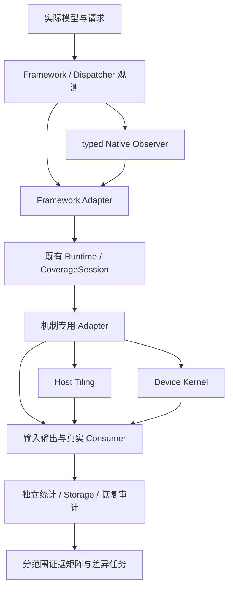

# DemonCATPFI 工程集成

本次基线是 `codex/17-fault-c2c3-closure-20261117` 的 `8f73f829`。工程公共能力沿用仓库现有实现，新增 `engineering_closure` 作为调用层发现、接口选择、构建审查、证据关联和执行准备入口。

| 工程目标 | 本次入口 | 复用的实际实现 |
| --- | --- | --- |
| E1 执行路径 | `path_discovery.py` | `model_discovery.inspect_structure`、`tensor_observer.NaturalTensorObserver`、Worker scheduler context |
| E2 Native 观测 | `native_observer.py` | typed DynamicQuant/Writer26 inventory reader、既有 CoverageSession 及 Provider 生命周期 |
| E3 Operator Adapter | `operator_adapters.py` | ModelFaultBackend、TensorGroup、Native39、postwrite/KV、StrategySession |
| E4 Tiling / Kernel | `kernel_adapters.py` | NativeBuildManager、FA certificate/POD、FIA final argument/ELF/launch 审查 |
| E5 环境兼容 | `compatibility.py` | environment inspection、recipe/ABI/loaded-map 验证 |
| E6 证据和调度 | `evidence.py`、`queue.py` | coverage_audit、statistics_audit、原有 case factory 与单一 NPU controller |

实际图中的每条边使用 `OBSERVED`、`INFERRED`、`NOT_VISIBLE` 或 `NOT_EXECUTED`。模块结构只能提供候选和逻辑角色。真实 Native 路径由 typed 调用窗口与 dispatcher token 关联。异线程、异 Worker、缺少 Request、未观测 Host Tiling 或 Kernel 的边保留对应缺口。

生命周期继续由具体 Provider 控制。`IndependentCallObserver` 在准入前接收调用，`CoverageSession` 管理触发、预算和全组恢复，真实 Operator Adapter 提供唯一调用、数值作用和设备 drain。请求行、executor、cache epoch 和 Storage lifetime 独立参与身份。共享地址或相同 shape 无法单独确立调用关系。

LD_PRELOAD 入口适用于已有实际拦截证据的调用链。Torch Dispatcher、ATB、自定义 API、私有 FIA 库和图执行各自通过对应 Adapter。动态库加载、符号归属、实际进入和数值效果分别留有回执。Fault41 延续真实 KV writer/cache/FIA 路线。

跨模型发现使用实际模块与执行调用，Qwen、DeepSeek、GLM、Qwen3-VL 和 SmolLM2 的历史记录按各自模型范围保存。CANN 8.5.1、9.1 和 A2/A3 的 ABI、源码、构建和 Worker 结果分别核对。环境探测能给出适配差异，实机验收负责授予具体运行范围。

当前工程验证范围是本地 CPU、Native mock 和可用 Linux ELF 加载测试。远端模型权重、原始 NPU 统计、CANN SDK 和黄区宿主 CLI 接入均有独立交付条件，见 `mechanism_matrix.csv` 与各批次清单。
