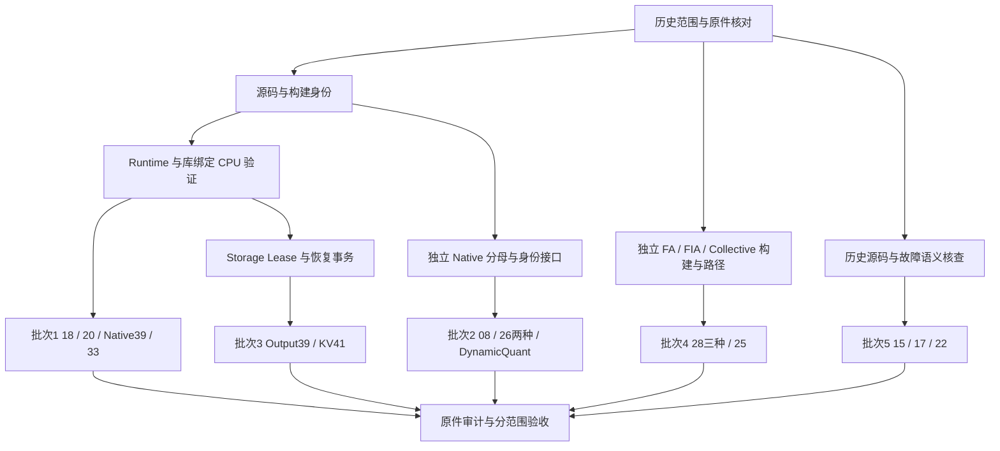

# NPU 差异验收队列

五批清单将 17 个机制各列一次。批次表示建议优先次序，任务按自身依赖准备。独立任务可在前序批次存在研究缺口时继续。所有实机运行复用 `experiments/c2c3_closure_20261117/run_queue_124.py` 的锁、设备检查、预算、失败停止和本任务容器清理。



`python -m engineering_closure queue` 列出全部缺失的进入条件。`--receipts` 接收 JSON 数组，每条包含 `job`、`gate`、`status`、`scope`、`reviewer`、`artifact`、`sha256`。scope 必须与 batch 条目一致，原件必须存在且哈希匹配。范围相同的审查回执使任务进入 `READY_TO_PREPARE`。报告保留 `queued_npu_processes=0`，实际设备检查由原控制器在执行时完成。

源码、构建、库绑定和资源窗口都须来自将要执行的环境。Fault33 的 device-backed 初始化就是本次待运行的工作，进入条件只要求先通过库绑定和构建检查。Fault25 先定义新故障样本搜索方案，已完成的健康通信校准直接继承。Fault20 和 FIA legal tiling 首先进行已有原始统计审计，无须占用 NPU。Fault17、22 先取得历史源码和验收语义。

生成常用任务时复用原 case factory。

```powershell
python -m engineering_closure prepare worker18-statistics --options worker18-options.json --out worker18-cases.json
python -m engineering_closure prepare 41.tail_column --options kv41-options.json --out kv41-cases.json
```

Worker18 options 需要实际 Linux 冻结源码路径 `source`，可传 `card` 和 `image`。KV41 options 需要 `source`、`native`、实际 `sha256`、`build_fingerprint` 和 `model`，支持 `cards`、`expected_targets`、`max_seconds`。输出复用原控制器的 schema 并经过 `validate_cases`。28 目标只是当前预期，探针必须在本次真实运行中重新核对。

其余任务的 `preparation_entrypoint` 指向已有脚本。运行这些脚本的 `--help` 后提供本次实际 source/build/model 输入。FA 专属源码对账和 FIA replay 自然模型桥接仍在各自清单内列为待实现条件，独立 FIA launch 探针不能替代这些入口。

在原 Linux 实验机上使用 `python3 experiments/c2c3_closure_20261117/run_queue_124.py --cases <cases.json> --cards 2 --attempt <new-attempt>` 执行已审查、有资源窗口的任务。该现有控制器针对原 124 环境，迁移黄区时需接入实际路径、设备资源管理和宿主 CLI。

历史通过项、被外部中断的尝试和本次补证据保持独立。Worker41 从新 attempt 的 Baseline 开始，旧中断回执继续保留。完整 C2 同进程通过后才能继续该次 live C3。历史回执只用于避免重复已完成工作。
